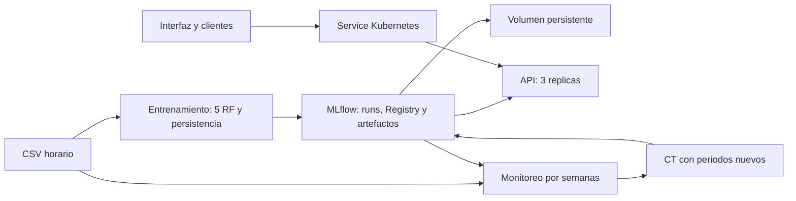

# Entrega individual: temperatura de colmenas y MLOps

Autor: Rider Arvin Gallo Heredia. Actualización: 4 de noviembre de 2026.

## Alcance definitivo

Esta versión sustituye la propuesta inicial de peso a 24 horas del documento
`ANALISIS_PROYECTO_FINAL_APICULTURA.md`: pronostica **temperatura media a una hora**
con el CSV real Schwartau disponible. Mantiene el flujo de experimentación,
Registry, Docker, Kubernetes, drift y reentrenamiento. No predice humedad,
presión ni peso, ni conecta sensores IoT en vivo. Es una base de ingeniería
para la tesis, no una validación de las cuatro variables ni un diagnóstico apícola.

Las cuatro entradas son temperatura actual, retardos de una y dos horas y media
de seis horas. Son variables derivadas de un único sensor, no cuatro sensores.
Todas las responsabilidades corresponden al autor: datos, modelo, API,
contenedores, clúster, automatización y defensa.

## Datos y límites

`data/temperatura.csv` contiene 21.120 horas entre enero de 2017 y mayo de 2019;
175 quedan sin dato. Se obtiene del CSV original de 253.430 registros.
La preparación descarta 2.080 filas inválidas o ambiguas, agrega por hora con
al menos seis mediciones y no interpola huecos. La hora representa el cierre
del intervalo; se exige continuidad para construir retardos y etiquetas.

| Campo | Significado |
|---|---|
| timestamp | Cierre horario con zona UTC |
| temperatura | Media de temperatura en °C; vacío si cobertura insuficiente |

La zona `Europe/Berlin` del original sin offset es un supuesto pendiente de
confirmar con la fuente. También quedan por confirmar su licencia y ubicación
exacta del sensor. El paquete excluye el CSV; no se presupone permiso para
redistribuirlo. `evidencias/dataset.json` contiene hash, fechas y conteos.
Los datos alemanes no prueban generalización al apiario local de la tesis.

## Selección del modelo

Se comparan cinco Random Forest y persistencia en los mismos cortes temporales
60/20/20 de 2017, purgando las etiquetas que cruzan fronteras. Se selecciona
por MAE de validación; en empate se prefiere persistencia. El test no selecciona.

| Modelo | MAE de validación (°C) |
|---|---:|
| RF 50, profundidad 5 | 0,3672 |
| RF 100, profundidad 5 | 0,3663 |
| RF 100, profundidad 10 | 0,3302 |
| RF 150, profundidad 10 | 0,3280 |
| RF 150, profundidad ilimitada | 0,3333 |
| Persistencia | **0,2711** |

Persistencia queda como `champion` y el mejor RF como `alternativa`. Su MAE
histórico de test es 0,1065 °C. No se afirma que un modelo aprendido supere la
referencia. La corrección de política se hizo después de observar resultados
previos; este test histórico no constituye una nueva evaluación ciega. Para
investigación adicional deben reservarse periodos posteriores antes de ajustar.

Los registros existentes conservan versiones anteriores bajo `previous`.
`inicializar --actualizar-politica` migra una sola vez el bootstrap antiguo;
las ejecuciones siguientes reutilizan el campeón. Las versiones numéricas son
propias de cada Registry: consultar `/health/ready`, no asumir siempre v2 o v4.
Esta migración corrige la selección inicial; no se presenta como una promoción
por CT sobre nuevas observaciones.

## Arquitectura



MLflow tiene una réplica y SQLite en volumen persistente. El despliegue local
no tiene alta disponibilidad ante caída completa del nodo. La API carga una
versión al arrancar y comprueba `MODEL_VERSION_EXPECTED`. Una promoción requiere
un despliegue posterior; cambiar el alias por sí solo no recarga los pods.

## Evidencias y criterios

| Requisito | Implementación y evidencia |
|---|---|
| Experimentos y versiones | `evidencias/entrega.json`, `experimentos.png`; seis runs por entrenamiento y Registry real |
| API y contenedor | Respuesta válida, modelo/run/pod y rechazo 422 en `entrega.json` |
| Tres réplicas | `evidencias/kubernetes.json`: pods Ready, UID e imagen |
| Balanceo | Conteo de 100 peticiones al Service por pod |
| Autorreparación | Eliminación de un pod, 150 peticiones y UID del reemplazo |
| Escalado | Tres → cinco → tres; estados registrados |
| Rollout y rollback | Revisión de configuración, retorno y peticiones posteriores |
| Drift controlado | `evidencias/ciclo/drift_*.json` y `drift.png` |
| CT real | `ct_real.json`: sin alarma sostenida, no reentrena |
| CT completo de laboratorio | `ciclo/ct_periodico.json`: aprobado y promovido; `ct_impredecible.json`: rechazado |
| Periodos no reutilizables | `ciclo/resumen.json`: bloqueo del test consumido tras rechazo |
| CI local | Tests y smoke real dentro de la imagen; `ci_local.log` |
| CI/CD/CT GitHub | Workflows preparados; ejecución remota pendiente de push y configuración del runner |
| Interfaz adicional | `/`: formulario pequeño que consulta la misma API |

La prueba de rollback espera la actualización de endpoints antes de enviar
peticiones. Comprueba disponibilidad posterior, no demuestra cero errores
durante toda la actualización. La prueba de eliminación sí mantiene tráfico.

## Drift y CT

El monitoreo compara KS por entrada con umbral D > 0,20. La alarma de desempeño
requiere tres semanas con MAE superior a `max(1,3 × MAE_validación,
MAE_validación + 0,5 °C)` y cobertura mínima del 80 %. Las etiquetas necesitan
una hora; un lote incompleto queda pendiente y rompe la racha.

El control verde de laboratorio es sintético y estable. No se fuerza a verde
el histórico real, que puede mostrar estacionalidad. El escenario de datos
desplaza X; el de concepto desplaza y manteniendo X idéntica. Las inyecciones
del detector no autorizan reentrenar sobre las etiquetas reales originales.

La demostración CT genera dos snapshots sintéticos completos con semilla 42,
en registros aislados. Se observa primero una alarma y se reserva validación
y test posteriores. Un patrón periódico permite aprobar un candidato; un
proceso impredecible produce rechazo frente a persistencia. No son resultados
biológicos ni estimaciones de rendimiento sobre colmenas reales.

En CT, el candidato debe superar al campeón al menos 5 % y a persistencia en
el mismo test nuevo. Se conserva `previous` al promover. El tag `ct_test_fin`
reserva el periodo antes del entrenamiento, incluso si se rechaza o falla:
no repetir CT con el mismo test. Ejecutar un ciclo a la vez; los workflows
comparten exclusión con CD. Un fallo exige inspeccionar el registro y aportar
un periodo posterior, no borrar el tag para reutilizar el test.

## Guion de defensa (10 minutos)

1. Delimitar temperatura a una hora y explicar las cuatro entradas históricas.
2. Abrir MLflow, comparar los seis runs y mostrar por qué gana persistencia.
3. Abrir la interfaz, predecir y relacionar versión/run con el Registry.
4. Mostrar las cuatro evidencias de Kubernetes y distinguir pod de nodo.
5. Mostrar el control verde, las alarmas rojas y la última semana pendiente.
6. Mostrar aceptación y rechazo CT, con datos sintéticos claramente identificados.
7. Explicar CI, entrega de imagen, CD local y CT por snapshot; distinguir
   workflows escritos de ejecuciones realmente observadas en GitHub.

## Reproducción y paquete

Seguir primero [DESPLIEGUE.md](DESPLIEGUE.md), luego [AUTOMATIZACION.md](AUTOMATIZACION.md).

```powershell
python -m unittest discover -s tests -v
python scripts/demostrar_ciclo.py
python scripts/verificar_kubernetes.py
$env:MLFLOW_TRACKING_URI = 'http://127.0.0.1:15050'
python scripts/recopilar_entrega.py
python scripts/empaquetar.py
```

El ZIP se genera en `artifacts/entrega_proyecto.zip`: código, instrucciones y
evidencias, sin datasets, entornos, bases MLflow ni credenciales. La evidencia
identifica HEAD y si había cambios sin commit; no atribuye esos cambios al HEAD.
No se fabrican commits ni ejecuciones de Actions. Para la entrega académica,
guardar los cambios en Git, ejecutar CI remoto y añadir su enlace al informe.
